# KIKI

KIKI is a desktop app for setting up and running a team of AI agents on your own repositories.

You describe each agent once: its role, the repositories it may touch, the other agents it works with, the MCP servers and CLI tools it may use. KIKI turns that setup into a launch prompt, starts the agents on an agent orchestrator, and checks what they do through guardrails. You also give the agents work from a task board and follow their progress there.

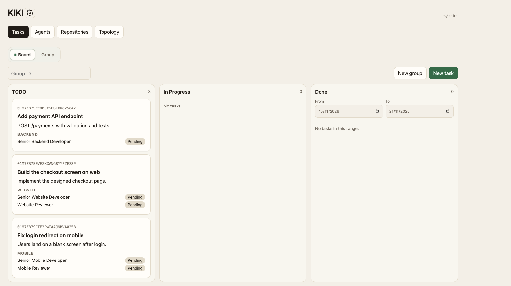

## What KIKI does

| Area | What you get |
| --- | --- |
| **Agents** | One markdown file per agent, grouped by category. Each agent has its own AI tool (Cursor, Claude, Codex, or Gemini), model, and prompt. Roles for requirement, backend, website, and mobile work are included. |
| **Agent to agent** | **Agents Coordination** says which agents an agent works with. Each link has messages: when to send, what to send, what the other agent reports back, and how many back-and-forth loops are allowed. |
| **Agent to repository** | Each agent is given the repositories it may open, a guide file to follow in each one (`AGENTS.md` by default), a note on what it does there, and an optional read-only flag. |
| **MCP Servers** | Set up an MCP server once in Settings (Atlassian: Jira and Confluence). Then choose it per agent, with a note on how that agent should use it. KIKI adds the server to the agent's AI tool before a run. |
| **Tools** | CLI tools turned on in Settings: GitHub CLI (chosen per agent) and RTK (applies to every agent). |
| **Repositories** | Document, Backend, Website, and Mobile repositories. Clone each one through Git, or point KIKI at an existing folder. A code repository can be an Nx monorepo, and you pick which projects the agents work on. |
| **Team Sharing** | Share agent and repository setups through one shared folder. You decide how that folder is synchronized between team members' computers (Dropbox, iCloud Drive, a network drive, a git repository, or anything else). KIKI compares, shows the diff, and copies in either direction. |
| **Indexes** | One-click setup of [CodeGraph](https://github.com/colbymchenry/codegraph) and [Obsidian](https://obsidian.md/) indexes for a repository. Agents query the index first, so they read less code and spend fewer tokens. |
| **RTK** | Turns on [RTK](https://github.com/rtk-ai/rtk) for Cursor, Claude, Codex, and Gemini. RTK rewrites shell commands so their output is shorter, which cuts input tokens. |
| **Information providers and CLIs** | Connects to Atlassian (Jira, Confluence) through MCP, and to the GitHub CLI, the RTK CLI, and the Cursor, Claude, Codex, and Gemini CLIs. Settings shows which are installed. |
| **Tasks** | Create tasks, group them under a group (a Jira epic when Jira is on), pick the agents, and send them to the orchestrator. The board tracks each agent from pending to completed. |
| **Agent Orchestration** | Agents are started and coordinated through Orca (the `orca` CLI). Orca is the only orchestrator supported today. |
| **Guardrails** | A hook on each AI tool checks every prompt, command, file, MCP call, and agent call against what that agent was given. It blocks anything else. |
| **Topology** | A map of each agent, the guardrail, MCP servers, tools, repositories, and indexes it may use. |

## Screenshots

### Agents

Every agent is a card with its AI tool and model. The **Team Sharing** card at the top compares this app's agents with your team folder.

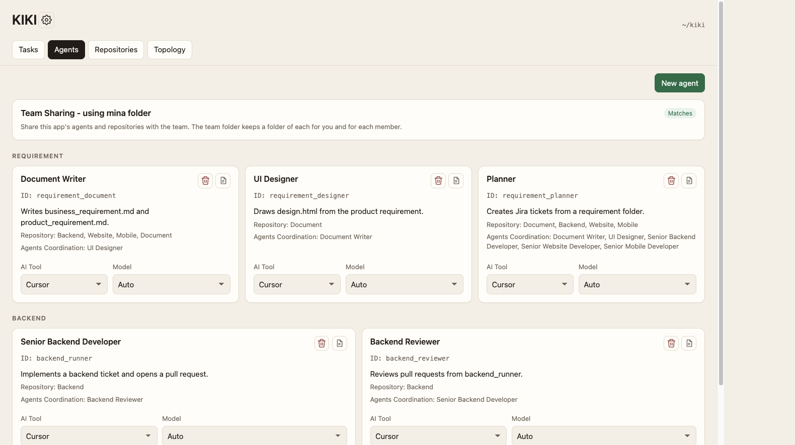

Edit an agent to set its prompt, repositories, coordination with other agents, MCP servers, and tools.

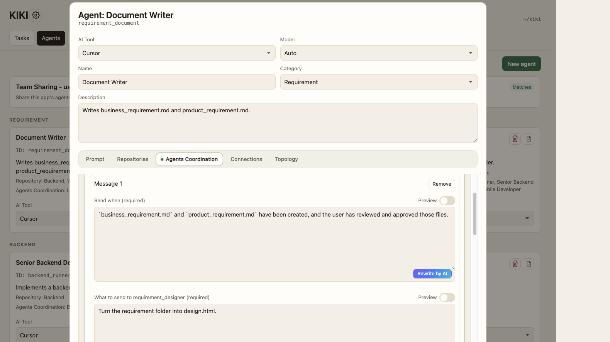

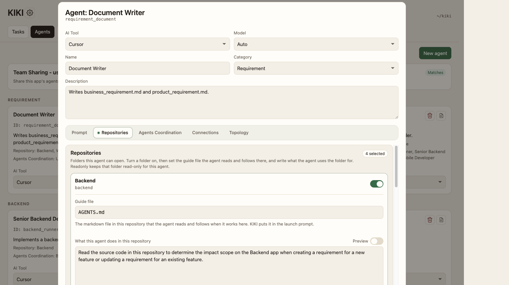

### Repositories and indexes

Each repository has a folder and an optional index. Turn the index on to set up CodeGraph or Obsidian in that folder.

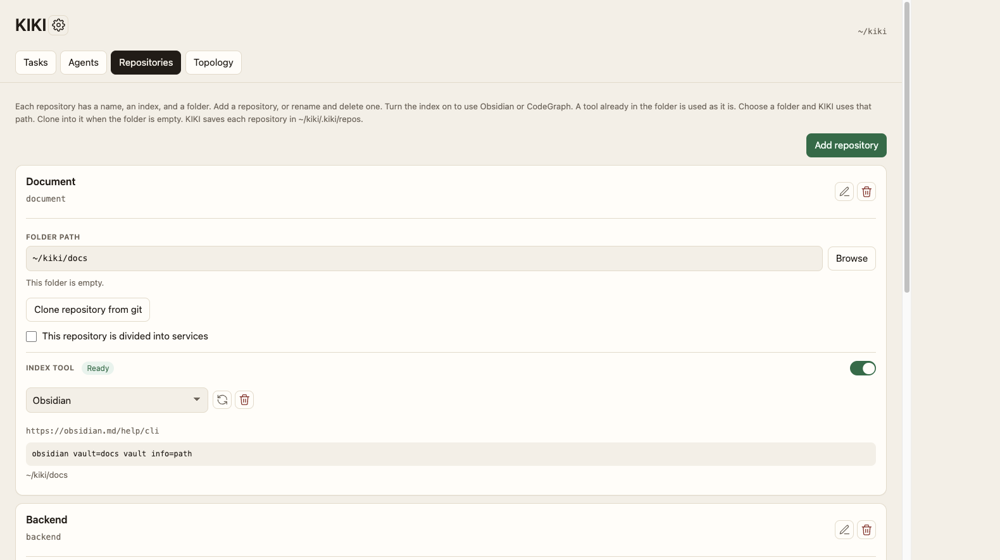

### Tasks

Choose the agents for a task. An agent also turns on the agents in its Agents Coordination, and those wait for a request before they work.

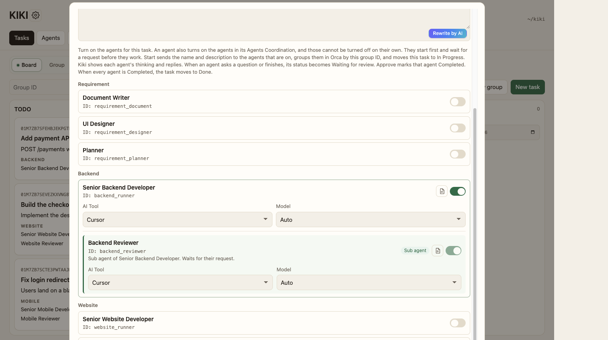

### Topology

Select an agent to see what it may reach. Lines go through the guardrail.

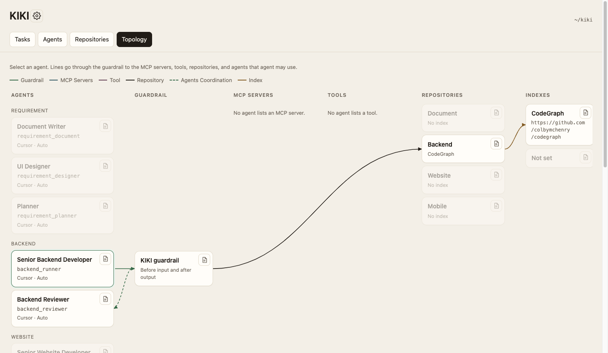

### Team Sharing

Compare this app's agents and repositories with your own folder or with another member's folder, then copy in the direction you choose.

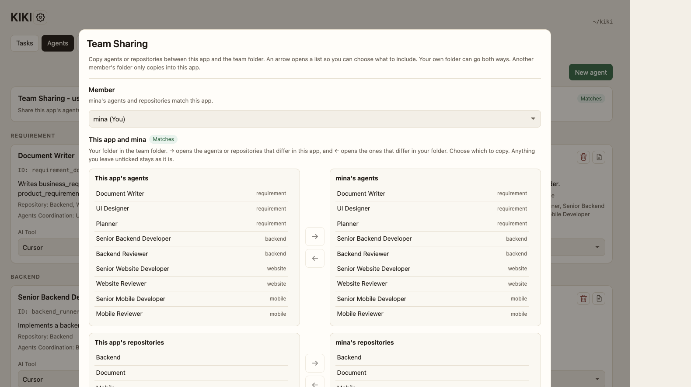

### Settings

Settings holds the orchestrator, the team folder, guardrails, MCP servers, and tools (including RTK).

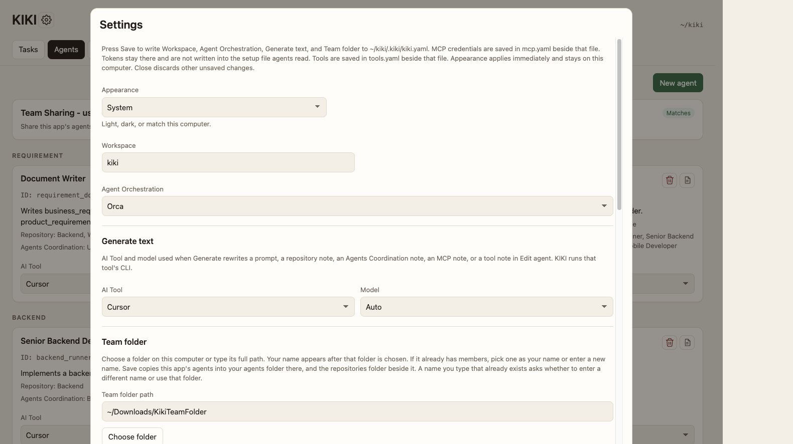

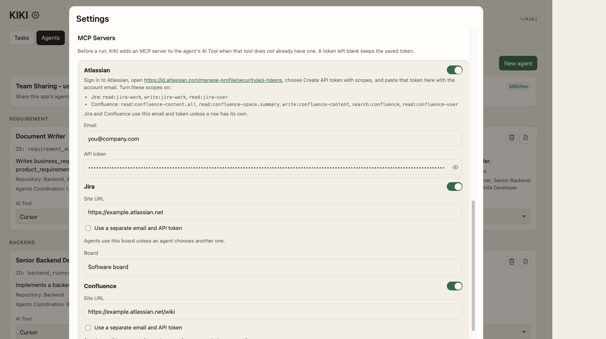

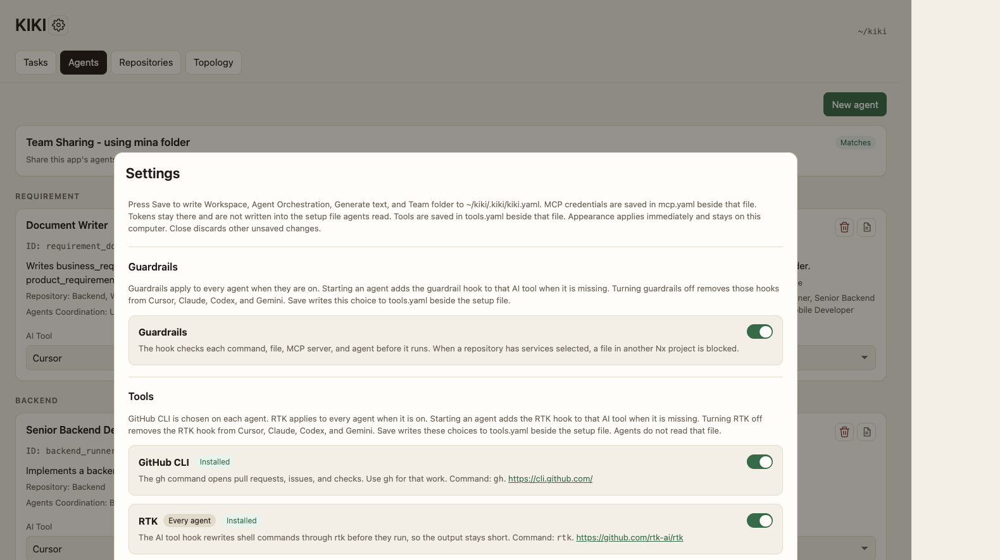

## Install and run

Requirements:

- macOS with the Xcode command line tools (the window uses WebKit, and SQLite is compiled from source, so the build needs a C compiler)
- [Rust](https://rustup.rs/)
- [Node.js](https://nodejs.org/) with `npm` (it only provides the Tauri CLI)

KIKI is a [Tauri](https://tauri.app/) app. From this directory:

```sh
npm install
npm run build     # builds src-tauri/target/release/bundle/macos/KIKI.app (and a .dmg)
npm run dev       # runs the app in development mode
```

KIKI keeps its files next to the app (see "Files next to the binary"). Open `KIKI.app` and it uses the folder that holds it. In development the files go next to the debug binary, so set the folder yourself: `KIKI_ROOT=$PWD npm run dev`, or pass `--root` to the binary.

Options of the binary (after `--` when you use `npm run dev -- --`): `--addr` changes the loopback address (default `127.0.0.1:8787`), `--root` sets the folder for KIKI's files, and `--no-open` serves the web UI at that address without a window.

Put these on `PATH` for the features you use:

| Command | Needed for |
| --- | --- |
| `orca` | Starting agents. Orca must be installed and running. |
| `cursor-agent`, `claude`, `codex`, `gemini` | The AI tool of each agent. A tool whose CLI is missing is listed but cannot be chosen. |
| `git` | Cloning repositories. |
| `node`, `npx` | Agents run `npx nx` inside a code repository that is an Nx monorepo. |
| `codegraph` | The CodeGraph index. |
| `obsidian` | The Obsidian index. Needs the Obsidian app 1.12 or newer, with **Settings → General → Command line interface** on. See the [Obsidian CLI](https://obsidian.md/help/cli). |
| `gh` | The GitHub CLI tool. |
| `rtk` | RTK. |

## How to use KIKI

A typical first run, in order:

### 1. Settings

Open Settings with the gear next to the title. Press **Save** to keep changes. **Close** discards them.

- **Workspace** is a short id: a letter, then letters, digits, `_`, or `-`.
- **Agent Orchestration** is Orca.
- **Team folder**: see step 6.
- **Guardrails**: leave on. KIKI installs the hook into Cursor, Claude, Codex, and Gemini when an agent starts.
- **MCP Servers**: turn on Atlassian, then enter your email and an [Atlassian API token](https://id.atlassian.com/manage-profile/security/api-tokens). Turn on Jira, Confluence, or both, and pick a default board, space, and parent page. A token you leave blank keeps the saved one.
- **Tools**: turn on GitHub CLI and RTK (see step 5).

### 2. Repositories

Open the **Repositories** tab. KIKI keeps four repositories as folders next to the binary.

| Folder | Kind | Used by |
| --- | --- | --- |
| `backend/` | backend | Backend developer and reviewer |
| `website/` | website | Website developer and reviewer |
| `mobile/` | mobile | Mobile developer and reviewer |
| `docs/` | document | Document writer, UI designer, and planner |

- **Browse** points a repository at another folder.
- **Clone repository** fills an empty folder from a Git URL. Fill **Folder** to check out only that folder (plus files at the repository root). Commit, push, and pull then use that checkout.
- A code repository can be one project or an Nx monorepo. Each Nx project has a `project.json`, and its `name` is the service name. The services you select are what the agents for that repository are told to work with. Agents confirm a project with `npx nx show projects`.

### 3. Indexes

On the same tab, turn **Index tool** on for a repository and choose CodeGraph or Obsidian. KIKI runs the setup in that folder (`codegraph init <folder>` for CodeGraph) and shows the progress.

- A repository has one index. Choosing the other one replaces it.
- A folder that already has `.codegraph` or `.obsidian` is picked up automatically.
- The refresh icon checks that the index is still there. The bin icon removes it.
- The launch prompt gives query instructions only for repositories that have an index. Agents are told to query the index before they search or read files.

### 4. Agents

Open the **Agents** tab. Each card has an AI tool and a model. **Edit** opens the full setup:

- **Prompt**: the role. Turn **Preview** on to read it as markdown.
- **Repositories**: turn a repository on, then set the guide file and what the agent does there. **Readonly** keeps that repository read-only for this agent.
- **Agents Coordination**: turn on the agents this one works with, then add messages. A message has **Send when** (the condition) and **What to send** (the content). Both are required. A third field says what the other agent reports back. When it is empty, no report is requested. Once it has text, you can allow a back-and-forth exchange of up to 20 loops.
- **MCP Servers**: the servers this agent may call, with a note on how to use each one.
- **Tools**: the CLI tools this agent may run.
- The **On** switch keeps the file but leaves the agent out of task starts.

The sparkle button (**Rewrite by AI**) on a text field rewrites it with the AI tool and model chosen under **Generate text** in Settings. You see both versions side by side and press **Use** to accept.

The document icon on a card shows the exact prompt KIKI sends to Orca.

### 5. MCP Servers, Tools, and RTK

- An MCP server set up in Settings shows in each agent's **MCP Servers** section. Only the servers set on an agent can be used by that agent.
- **GitHub CLI** is turned on per agent in **Tools**.
- **RTK** applies to every agent while it is on. Starting an agent adds the RTK hook to that agent's AI tool when it is missing. Turning RTK off removes the hook from Cursor, Claude, Codex, and Gemini.

### 6. Team Sharing

1. In Settings, set **Team folder** to a folder shared by your team. You choose how that folder is synchronized between computers.
2. Enter your name. If the folder already has members, you can pick one or type a new name.
3. Save. KIKI copies `.kiki/agents` to `<team>/<name>/agents` and the repository setup to `<team>/<name>/repos`.

On the **Agents** tab, open the **Team Sharing** card. Pick a member, see which agents and repositories differ (open one to see the diff), and use the arrows to copy. Your own folder can be copied both ways. Another member's folder is copied into this app only. Each copy asks before it overwrites. If a copied agent uses a repository this app does not have, KIKI asks you to create it or map it to an existing one.

### 7. Tasks

On the **Tasks** tab:

1. **New group** (optional) makes a group. When Jira is on, a Jira epic is created on the board chosen in Settings.
2. **New task**: enter a name and a description, choose a group, and turn on the agents. An agent also turns on the agents in its Agents Coordination. Those wait for a request.
3. **Start on Orca** shows the prompt each agent will receive. You can edit it. Nothing starts until you confirm. KIKI opens an Orca worktree for each repository an agent uses and launches the agent there.
4. The task moves to **In Progress**. Each agent shows as Pending, Doing, Waiting for review, or Completed. KIKI shows each agent's thinking and replies.
5. When an agent asks a question or finishes, it is **Waiting for review**. Reply to it, or press **Approve** to mark it Completed.
6. When every agent is Completed, the task moves to **Done**.

**Save** keeps a task as a draft in TODO. Switch between **Board** and **Group** to see tasks by status or by group.

### 8. Topology

The **Topology** tab draws what each agent may reach. Select an agent to highlight its guardrail, MCP servers, tools, repositories, coordinating agents, and indexes.

## Reference

### Agent files

Agents live in `.kiki/agents` next to the app, as `<category>/<id>.md`. The embedded roles in `src-tauri/crates/agents/` are copied there the first time the folder has no agent files. After that the files are yours: an update to an embedded role does not overwrite an agent you already have. To start again from the current embedded roles, move `.kiki/agents` away (keep a copy of agents you edited) and restart KIKI. The roles read their repositories, services, collaborators, MCP servers, and Jira board from the launch prompt, so they do not depend on any other config file. A file stores the id, name, description, whether the agent is on, AI tool, model, repositories (with guide file and note), `agents_coordination` (with `handoffs` as `when` and `send` pairs), MCP servers, tools, and the prompt.

| Group | Agents | Repository |
| --- | --- | --- |
| Requirement | Document Writer, UI Designer, Planner | Document. The planner also reads the three code repositories. |
| Backend | Senior Backend Developer, Backend Reviewer | Backend |
| Website | Senior Website Developer, Website Reviewer | Website |
| Mobile | Senior Mobile Developer, Mobile Reviewer | Mobile |

The writer turns a feature into `business_requirement.md` and `product_requirement.md`. The designer turns that into `design.html`. The planner turns the requirement folder into tickets. Each development pair implements and reviews only inside its own repository.

### Launch prompt

The prompt sent to Orca is the single source of truth for an agent's setup. The agent documents do not hold paths, Jira values, or MCP file names of their own. The prompt contains:

- The agent's id, the repository root, the Orca worktree, the setup file path, and the workspace id.
- For each repository: its folder, the guide file to read and follow (`AGENTS.md` unless you change it), the services, the work note, and the index query instructions. A sparse checkout names the one folder that is checked out, and **Readonly** tells the agent not to change, commit, or push.
- For each collaborator: its agent id and its messages (when to send, what to send, whether to ask for a report and what it must contain, and the loop limit when an exchange can go back and forth). The agent sends a message when its condition is met, not only when its work is done.
- The MCP servers set on the agent. Jira names the board, and Confluence names the space and parent page.
- The tools set on the agent.
- The Jira epic, as a `Jira epic:` block, when the task belongs to a group that has one and the epic is on the agent's board.
- The user message, when the task has one.

An agent that was turned on only because another agent lists it under Agents Coordination gets a **wait for a request** instruction. It does no work, reads no repository, and calls no Jira tool until a request from that agent reaches it.

### Files next to the binary

KIKI writes its files in `.kiki` beside the executable, not in the current working directory. Repository folders stay beside the executable.

| File | Contents |
| --- | --- |
| `.kiki/kiki.yaml` | Workspace, orchestrator, repository folders, selected services, and team folder. |
| `.kiki/repos/` | One file per repository (`backend.yaml`, `website.yaml`, `mobile.yaml`, `document.yaml`) with its folder, services, and index. |
| `.kiki/agents/` | Agent files, `<category>/<id>.md`. |
| `.kiki/mcp.yaml` | MCP credentials for this computer. Agents do not read it. |
| `.kiki/tools.yaml` | Tools and guardrails choices for this computer. Agents do not read it. |
| `.kiki/kiki.db` | Tasks, groups, and recent runs. |

Keep `.kiki/mcp.yaml` out of version control and out of the team folder. It holds your API token.

### AI tools

The AI Tool of an agent is `cursor`, `claude`, `codex`, or `gemini`. Guardrails and the RTK hook are installed for all four. Claude model names are the current aliases from the Claude Code model config.

## Development

```sh
cd src-tauri
cargo fmt --all
cargo clippy --workspace --all-targets -- -D warnings
cargo test --workspace
```

The layout follows Tauri v2:

| Path | Contents |
| --- | --- |
| `src/` | The web UI (`index.html`, `app.css`, `app.js`, `transport.js`). |
| `src-tauri/` | The Rust side: `tauri.conf.json`, `capabilities/`, `icons/`, and the `kiki` package (`src/` holds the window, menu, IPC command, loopback HTTP adapter, and command line). |
| `src-tauri/crates/` | The libraries: `server` (the API and its services), `console` (launch prompts), `store` (SQLite), `jobs` (index setup), `guard` (guardrail policy and hook installers), `mcp`, `tools`, `agents` (embedded role files), and others. |

The web UI talks to the Rust core through one Tauri command, `api_request`. The same core also answers a loopback HTTP server, which the guardrail hooks use and which serves the UI in `--no-open` mode. See `AGENTS.md` for how to work in this repository.
